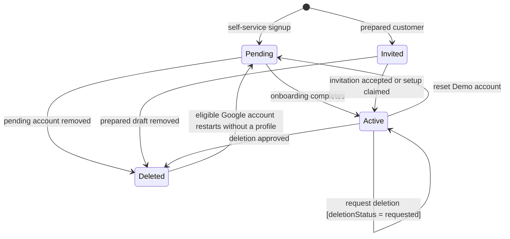
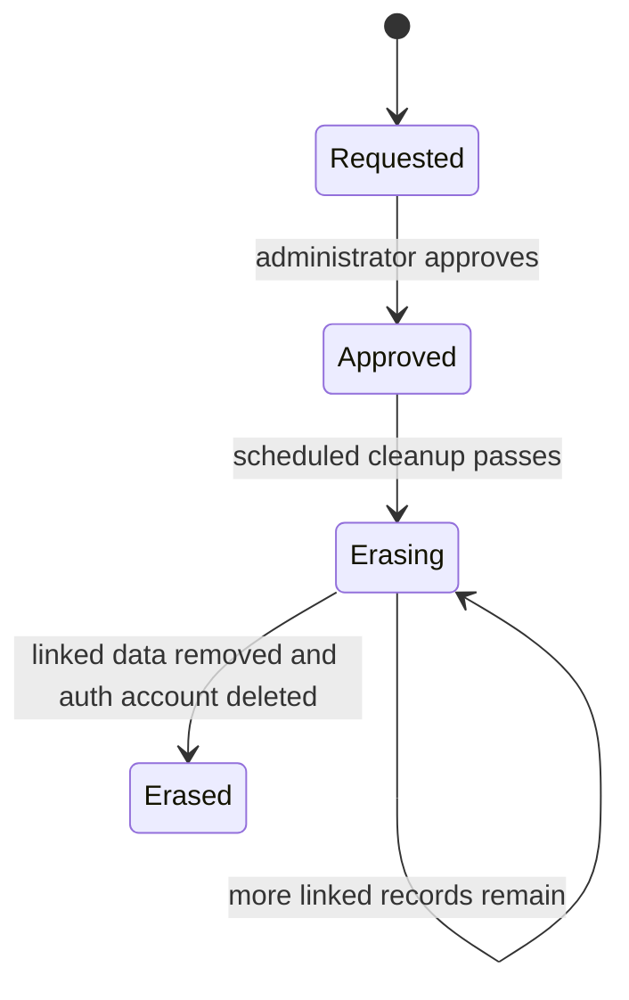
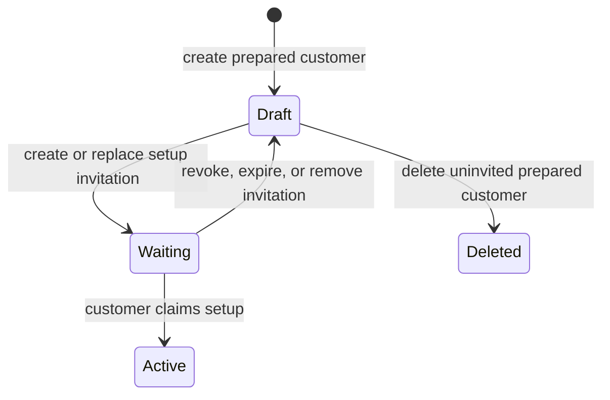
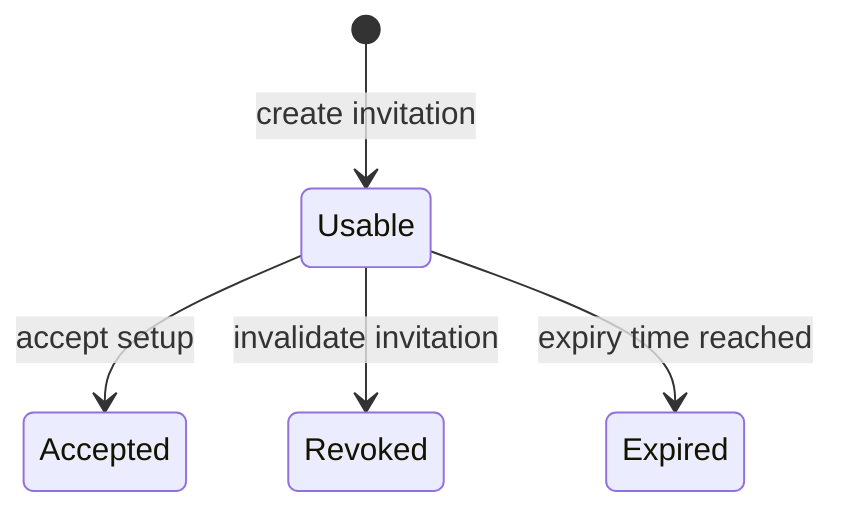
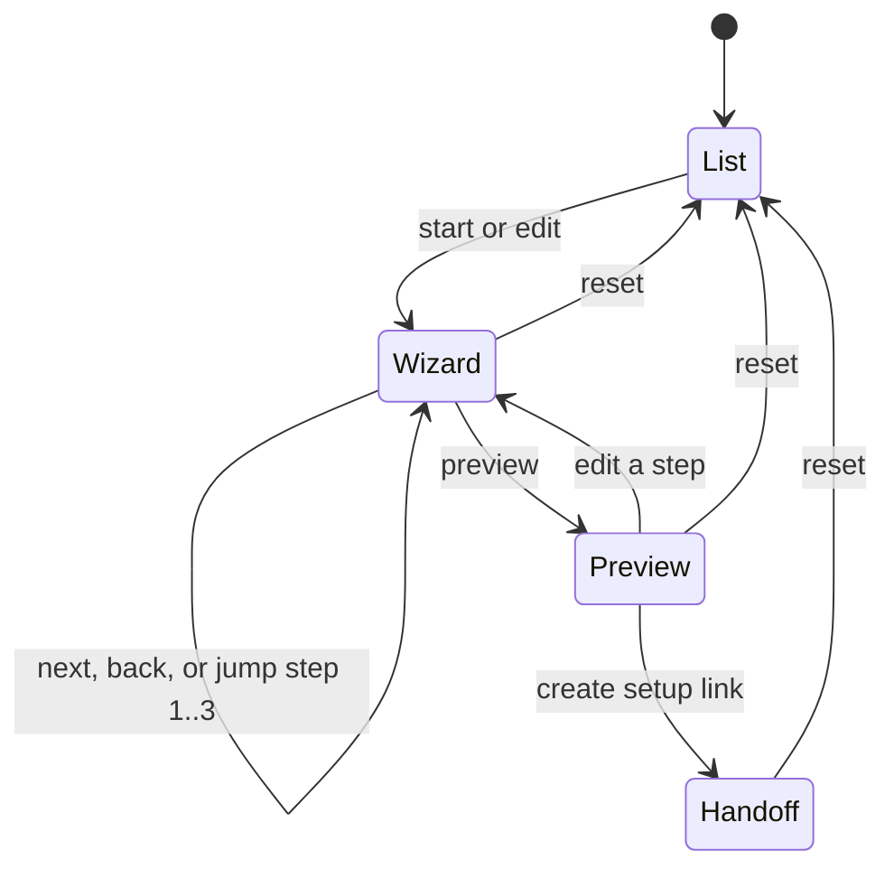
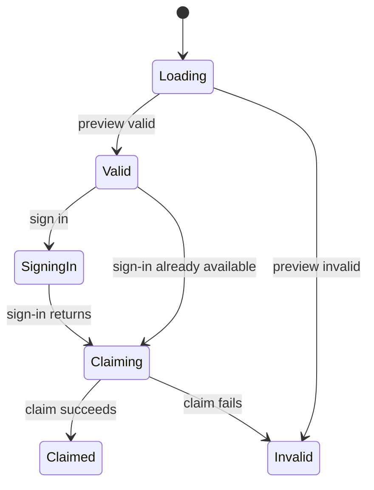
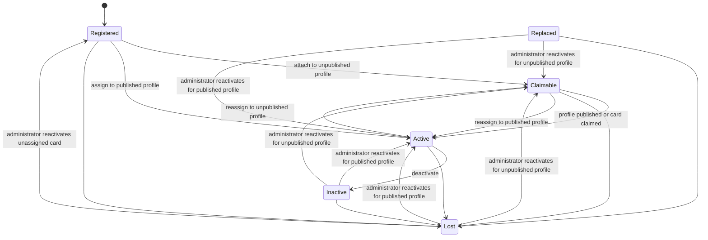
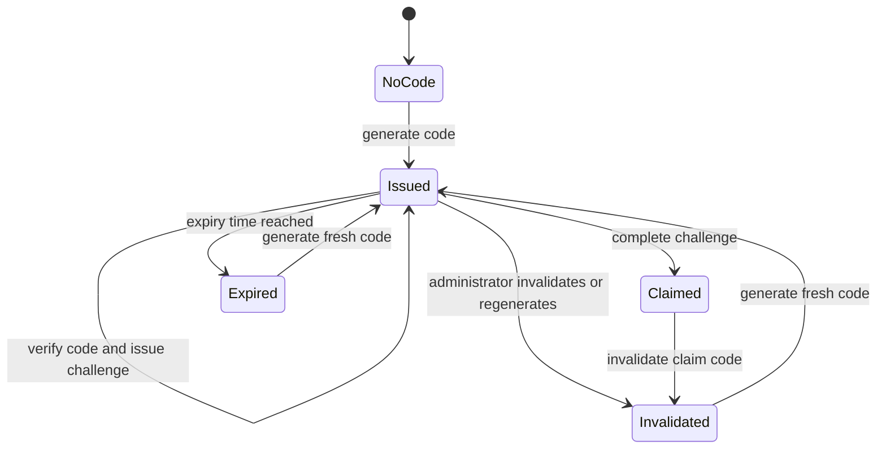
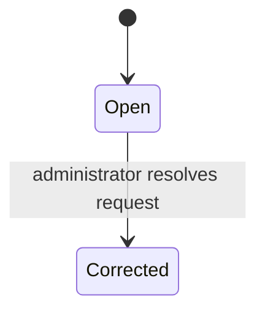

# Application state machines

This document makes the app's lifecycle behavior visible in one place. It records the states and transitions implemented in the current code, including lifecycles inferred from timestamps or composed from multiple fields. The source files remain authoritative; update this catalog when their behavior changes.

Runtime transition rules shared by Convex and local demo paths live in [`src/lib/domain/state-machines.ts`](../src/lib/domain/state-machines.ts). Existing reducers such as the prepared-customer wizard and setup-link claim screen keep their UI-specific transitions in their component modules.

## Account and setup

### Customer account and deletion

The customer record has an account lifecycle and a separate deletion lifecycle. They are not one flat status field.

Deletion request records have their own path: `requested → approved | rejected`. An approved request drives customer deletion and associated profile/card cleanup. The `Active → Active` edge above means the customer account status stays active while its separate `deletionStatus` becomes requested; access is restricted during that period.

Sources: [`convex/schema.ts`](../convex/schema.ts), [`convex/customers.ts`](../convex/customers.ts), [`convex/accountErasure.ts`](../convex/accountErasure.ts), [`src/lib/domain/index.ts`](../src/lib/domain/index.ts).

### Deletion request and erasure processing

Requesting deletion immediately restricts account access, unpublishes the profile, and makes assigned cards inactive. Approval marks the request approved and the customer deleted, then schedules repeatable cleanup passes for linked application data and eligible auth records. The schema declares `rejected`, but the current code has no rejection mutation or transition, so that value is unreachable through the app.

Sources: [`convex/customers.ts`](../convex/customers.ts), [`convex/accountErasure.ts`](../convex/accountErasure.ts), [`convex/schema.ts`](../convex/schema.ts).

### Prepared setup lifecycle

Prepared setup state is derived from the customer, invitation, and expiry information. It is not simply the invitation status.

The derived states are `draft`, `waiting`, and `active` (or no setup state for records outside prepared setup). Claiming activates the customer. Expiry/revocation returns a still-unclaimed prepared customer to draft.

Sources: [`convex/preparedSetup.ts`](../convex/preparedSetup.ts), [`convex/invitations.ts`](../convex/invitations.ts), [`src/lib/demo/store.ts`](../src/lib/demo/store.ts).

### Invitation lifecycle

Invitation lifecycle is implicit in `usedAt`, `acceptedAt`, `invalidatedAt`, and `expiresAt`; there is no persisted status enum.

An invitation is usable only while it is unaccepted, unused, uninvalidated, and unexpired. These conditions are represented by timestamps and checked by the invitation/setup operations.

Sources: [`convex/schema.ts`](../convex/schema.ts), [`convex/invitations.ts`](../convex/invitations.ts), [`convex/invitationAcceptance.ts`](../convex/invitationAcceptance.ts).

### Prepared-customer admin wizard

This client-side machine tracks screen and form step as two related parts of one reducer state.

Sources: [`types.ts`](../src/components/admin/prepared/types.ts), [`state.ts`](../src/components/admin/prepared/state.ts).

### Setup-link claim screen

Sources: [`setup-claim-state.ts`](../src/components/auth/setup-claim-state.ts), [`PreparedClaimPage.tsx`](../src/components/auth/PreparedClaimPage.tsx).

## Profile, card, and correction

### Profile publication

Owner publication transitions are `draft | unpublished → published`, `published → published` when saving a new published snapshot, and `published → unpublished`. The administrator status mutation accepts any of the four profile statuses from any current status; setting `published` requires a valid existing published snapshot. This means the admin path also allows direct transitions such as `draft → suspended` and `suspended → draft`.

The editable draft and the last published snapshot are separate data. Public projection is available only when status is `published` and a published snapshot exists. Publication also reconciles eligible claimable cards.

Sources: [`convex/schema.ts`](../convex/schema.ts), [`convex/profiles.ts`](../convex/profiles.ts), [`src/lib/domain/index.ts`](../src/lib/domain/index.ts).

### Card lifecycle

The domain transition requires a replacement ID for `active → replaced`, but the current administrator "Add replacement" action creates a new active card and leaves the old card's status unchanged. `replaced` remains a schema state that reactivation can consume, but the current action does not enter it. Archiving is an orthogonal flag allowed for inactive/replaced cards, and restoring clears that flag. Lost-card public resolution (`return` or `inactive`) is also separate from the card status.

Sources: [`src/lib/domain/index.ts`](../src/lib/domain/index.ts), [`convex/cards.ts`](../convex/cards.ts), [`convex/schema.ts`](../convex/schema.ts).

### Card claim code

Claim-code state is encoded in card timestamps plus challenge records, not one status enum.

The card must also be in an eligible card status and satisfy profile/owner checks. Challenge use is tracked by `usedAt`; the code's generation, expiry, invalidation, and claim times are stored on the card.

Sources: [`convex/cards.ts`](../convex/cards.ts), [`convex/cardClaims.ts`](../convex/cardClaims.ts), [`convex/schema.ts`](../convex/schema.ts).

### Card correction request

An open request also makes the related card unavailable through its public resolver. Resolution records the administrator and corrected profile.

Sources: [`convex/schema.ts`](../convex/schema.ts), [`convex/cards.ts`](../convex/cards.ts), [`convex/cardCorrectionRequests.ts`](../convex/cardCorrectionRequests.ts).

## Upload and order processing

### Generic upload asset

The schema and upload policy declare these status values: `initiated`, `uploaded`, `validating`, `processing`, `ready`, `attached`, `rejected`, `failed`, `expired`, and `deleted`. In the current code, those values are defined in the schema and type, but no writer transitions records in the `uploadAssets` table. Therefore the transition edges are **not yet established by runtime code** and are intentionally not presented as implemented behavior. The specialized upload workflows below are the active persisted upload machines.

Sources: [`convex/schema.ts`](../convex/schema.ts), [`convex/uploadPolicies.ts`](../convex/uploadPolicies.ts), [`convex/accountErasure.ts`](../convex/accountErasure.ts).

### Specialized upload records

Several upload workflows have their own persisted status machines alongside the generic upload asset:

| Record | States and transitions | Source |
| --- | --- | --- |
| Profile image/media upload job | `pending → attached \| failed`; erasure cleanup can mark an attached job failed | [`convex/schema.ts`](../convex/schema.ts), [`convex/profileImages.ts`](../convex/profileImages.ts), [`convex/profileMedia.ts`](../convex/profileMedia.ts) |
| Card design upload | `pending → processing → available → attached` | [`convex/schema.ts`](../convex/schema.ts), [`convex/cardOrderDesigns.ts`](../convex/cardOrderDesigns.ts) |
| Payment QR upload | `pending → processing → available → attached`; replacing the configured QR returns the prior attached upload to available | [`convex/schema.ts`](../convex/schema.ts), [`convex/cardOrderPaymentQr.ts`](../convex/cardOrderPaymentQr.ts) |
| Order receipt upload | `pending → processing → available → attached`; processing may fail, and an attached receipt may become `replaced` | [`convex/schema.ts`](../convex/schema.ts), [`convex/cardOrderReceipts.ts`](../convex/cardOrderReceipts.ts) |
| Local profile-media preview | `queued → uploading`; failure may set `failed` | [`profile-media-preview.ts`](../src/lib/profile-media-preview.ts) |

### Card order

An order combines three guarded state dimensions rather than one linear status:

- **Fulfillment:** `awaiting_shipping_quote → awaiting_payment → processing → delivered`. Unpaid open orders can move to `cancelled`; refunding an order in `processing` moves fulfillment to `cancelled`, while refunding a delivered order leaves fulfillment as `delivered`.
- **Payment:** `unpaid → received → refunded`.
- **Commission:** `none` for orders without a referrer; `pending → eligible → paid` for a referral order; unpaid cancellation or refund changes an unpaid commission to `void`. A commission already `paid` remains paid when the order is later refunded.

The guards require a shipping quote before payment, received payment before processing/delivery, and delivered plus received payment before referral commission eligibility/payout. Cancellation only applies to unpaid open orders; refund applies to received payment while processing or delivered.

Sources: [`convex/schema.ts`](../convex/schema.ts), [`convex/cardOrders.ts`](../convex/cardOrders.ts).

## Demo parity

The browser-local demo store implements parallel customer, setup, profile, card, and deletion lifecycles. Keep those paths behaviorally aligned with Convex where a workflow exists in both modes. Demo-only persistence/session hydration and cross-tab reconciliation are storage coordination flows, outside this domain lifecycle catalog.

Source: [`src/lib/demo/store.ts`](../src/lib/demo/store.ts).
